# Startary AI Architecture Baseline Audit (Milestone M6.0)

**Document Version:** 1.0 (Comprehensive Baseline Audit)  
**Date:** 2026-10-14  
**Audit Target:** Startary AI Engine (Frozen Alpha Core)  
**Repository Working Directory:** `Startary_AI_Latency`  
**Git Branch:** `ai-latency-langsmith`  
**Git Base Commit:** `a4db52e freeze Startary alpha core before web development`  
**Git Tag Snapshot:** `v0.4.1.4-alpha-core`  
**Audit Type:** Static Codebase Inspection & Baseline Telemetry Synthesis (READ-ONLY)  

---

## Executive Summary

This document establishes the authoritative, read-only architectural baseline of the Startary AI reasoning engine prior to the integration of LangSmith observability tooling. Every finding, schema, call site, formula, and routing rule documented herein has been directly verified against the repository source code at commit `a4db52e`.

### Key System Characteristics at a Glance
- **Orchestration Framework:** Compiled LangGraph state machine (`startary.graph.builder.build_graph`) managed via a StateGraph operating on a unified `StartaryGraphState` TypedDict, checkpointed in memory via `MemorySaver`.
- **Reasoning Architecture:** Dual-tier hybrid architecture combining **Fast Tier** models (`gpt-4o-mini` default / `gpt-5.6-luna`), **Reasoning Tier** models (`gpt-4o` default / `gpt-5.6-sol`), and **100% Deterministic Python Arbiters** (15+ nodes requiring zero LLM calls).
- **Interactive Modality:** Conversational Human-in-the-Loop (HITL) state machine featuring three distinct clarification interrupt loops (Baseline, Strategic Understand, Weak-Link Discrimination) and one persistent execution pause (`wait_for_evidence`).
- **Production Latency Baseline:** A full, un-cached founder turn from raw intake to a validated experiment design and execution handoff requires **293.72 seconds** (~4.9 minutes) of wall-clock time against live reasoning endpoints (`gpt-5.6-sol`), consuming ~18,000 prompt tokens and ~9,500 completion/reasoning tokens across 7–9 serial LLM calls.
- **Decision Authority:** Strict separation between generative synthesis (LLM-owned) and strategic control flow (Python-owned). Area risk ranking, weak link tie-breaking, experiment validation, execution readiness, build readiness, iteration counters, and next strategic action routing are completely deterministic.

---

## 0. Repository Verification

Prior to performing architectural analysis, repository identity and environment integrity were strictly validated against project expectations:

| Verification Parameter | Expected Value | Verified Value from Repository | Status |
| :--- | :--- | :--- | :---: |
| **Working Directory** | `Startary_AI_Latency` | `c:\Users\orxan\OneDrive\Masaüstü\Startary_AI_Latency` | ✅ MATCH |
| **Git Branch** | `ai-latency-langsmith` | `ai-latency-langsmith` | ✅ MATCH |
| **Git HEAD Commit** | `a4db52e` | `a4db52e freeze Startary alpha core before web development` | ✅ MATCH |
| **Git Snapshot Tag** | `v0.4.1.4-alpha-core` | `v0.4.1.4-alpha-core` (points directly to HEAD commit `a4db52e`) | ✅ MATCH |
| **Working Tree State** | Clean (no untracked/modified code) | `nothing to commit, working tree clean` | ✅ MATCH |
| **Target Scope** | Frozen AI-Only Alpha Core | Pure Python AI engine (`startary/`, `tests/`, `scripts/`) | ✅ MATCH |

> [!IMPORTANT]
> The current working tree is verified as the frozen core AI engine. No React frontend, FastAPI web services, or deployment infrastructure exist in this branch. All subsequent findings represent the exact runtime execution path of Startary's core reasoning system.

---

## 1. Current AI Architecture Overview

Startary is a specialized AI co-founder and venture scientist that guides early-stage founders through the lean scientific method: discovering their most lethal existential vulnerability (the **Weak Link**), isolating a single testable hypothesis (the **Critical Assumption**), designing a bounded real-world test (the **Experiment**), and updating strategic belief based on empirical results (the **Learning Loop**).

### Architectural Modules and File Boundaries

```
startary/
├── config.py                 # Pydantic Settings, tier resolution, logging configuration
├── cli.py                    # CLI loop, memory checkpointer, interrupt handling, error taxonomy
├── domain/                   # Pure Python domain entities, enums, taxonomy, rules
│   ├── taxonomy.py           # 10 canonical startup areas, ordinal risk factor mappings
│   ├── state.py              # StartupState, AreaKnowledge, provenance metadata
│   ├── assessment.py         # StartupAreaAssessment, RiskFactorLevel, score calculations
│   ├── diagnosis.py          # Diagnosis, StartupDiagnosisSnapshot
│   ├── assumption.py         # Assumption entity, grounding error classes
│   ├── experiment.py         # Experiment, Critic report, execution parameters, can_execute
│   ├── evidence.py           # Evidence, EvidenceAnalysis, LearningDelta, admission disposition
│   ├── execution_context.py  # Founder constraints (budget, team size, hours, skills, access)
│   ├── startup_progress.py   # Development stage, MVP status, quantitative traction
│   ├── strategic_action.py   # NextStrategicAction, action type enums
│   ├── build_readiness.py    # Deterministic build gates (problem, demand, revenue)
│   ├── customer_access.py    # Customer access status and channels
│   ├── gap_plan.py           # Strategic information-gap planning rules
│   ├── discrimination.py     # Weak-link discrimination resolution modes
│   ├── founder_intent.py     # Intent classification categories and response modes
│   └── terminal_state.py     # State machine terminal statuses and rendering helpers
├── graph/                    # LangGraph orchestration engine
│   ├── builder.py            # Graph construction, edge wiring, routers, subgraphs
│   ├── graph_state.py        # StartaryGraphState TypedDict definition
│   └── nodes.py              # 40+ node implementations, LLM invoke wrappers, token retry
└── llm/                      # Provider boundary and structured output contracts
    ├── provider.py           # Single ChatOpenAI boundary, preflight checks, token budget recovery
    ├── schemas.py            # Pydantic structured output models for all LLM calls
    └── prompts.py            # System and user prompt templates across all nodes
```

### Core Architecture Pillars

1. **Compilation and Graph Execution (`startary/graph/builder.py:399`):**  
   The primary graph is constructed by `build_graph(checkpointer=MemorySaver())`. The graph entry point is strictly registered as `initialize_state`. State transitions are governed by deterministic conditional router functions.
2. **Provider Boundary (`startary/llm/provider.py`):**  
   Startary strictly isolates external LLM libraries. `startary/llm/provider.py` is the **only** module that imports `langchain_openai.ChatOpenAI`. All graph nodes call `get_llm_client(...)` and receive a configured client with zero knowledge of underlying API details.
3. **Structured Output Invariant (`startary/llm/schemas.py`):**  
   Every LLM call in the main graph uses `.with_structured_output(SchemaClass, method="function_calling")`. Raw, unstructured completions are never consumed for decision making.
4. **Deterministic Authority:**  
   LLMs are used as semantic extractors, risk evaluators, hypothesis generators, and test designers. Crucially, **all routing, scoring, tie-breaking, admission gating, validation checks, iteration increments, and strategic state updates are 100% deterministic Python logic**.
5. **Human-in-the-Loop Interrupts (`startary/graph/nodes.py:32`):**  
   The system pauses execution using LangGraph's native `interrupt()` pattern in two nodes:
   - `ask_and_wait_for_founder`: Pauses to solicit founder clarification during Baseline, Strategic Understand, or Weak-Link loops.
   - `wait_for_evidence`: Pauses after presenting an accepted experiment handoff, awaiting real-world experiment results.
6. **State Persistence:**  
   Execution state is maintained in `StartaryGraphState` (a TypedDict with 60+ keys) and persisted across turns using LangGraph's thread-scoped `MemorySaver` checkpointer keyed by `project_id`.

---

## 2. Complete LangGraph Flow

### Flow Topology and Execution Lifecycle

The compiled graph executes across four distinct functional phases:
1. **Intake & Baseline Profiling:** Ingests founder input, passively extracts startup facts, merges them with provenance, and verifies whether the 5 minimum operational baseline fields are known.
2. **Strategic Understand & Diagnosis:** Evaluates strategic context, performs qualitative diagnosis, identifies critical knowledge gaps, and queries the founder if necessary (up to 5 turns).
3. **Risk Assessment & Weak Link Isolation:** Scores all 10 canonical startup areas, deterministically selects the primary Weak Link, resolves close ties via discrimination, validates claims against reality, and synthesizes a Critical Assumption.
4. **Experimentation & Execution Handoff:** Formulates an experiment, validates constraints, runs a self-critique loop, assesses execution feasibility, and hands off the action plan to the founder before pausing at `wait_for_evidence`.
5. **Evidence Intake & Learning Loop:** Intercepts founder responses, routes actual evidence through an extraction and analysis pipeline, validates empirical conclusions, applies state updates deterministically, increments the iteration counter, and triggers re-diagnosis.

### Registered Nodes Inventory Table

The following table documents every registered node in the compiled graph:

| Node Name | Implementation | Purpose | Inputs Consumed | Outputs Updated | Reasoning Type | Model Tier | Next Step / Router | Interrupt |
| :--- | :--- | :--- | :--- | :--- | :--- | :--- | :--- | :---: |
| `initialize_state` | `nodes.py:382` | Initializes default state keys, counters, and histories | `raw_context`, `project_id` | Initialized state dictionary | Deterministic | None | `verify_state` | No |
| `verify_state` | `nodes.py:442` | Validates presence of required startup context | `raw_context` | `is_valid`, `error_message` | Deterministic | None | `interpret_founder_turn` | No |
| `interpret_founder_turn` | `nodes.py:492` | Classifies founder intent, sentiment, and repair needs | `founder_messages`, `current_question` | `founder_intent`, `is_conversational_repair` | LLM | Fast (`gpt-4o-mini`) | `route_after_interpret_founder_turn` | No |
| `handle_conversational_repair` | `nodes.py:640` | Generates fast conversational redirect for off-track input | `founder_messages`, `founder_intent` | `conversational_repair_response` | LLM | Fast (`gpt-4o-mini`) | `ask_and_wait_for_founder` | No |
| `extract_startup_state` | `nodes.py:698` | Passively extracts operational facts with provenance | `founder_messages`, `execution_context` | `startup_state_delta`, `extraction_status` | LLM / Hybrid | Fast (`gpt-4o-mini`) | `merge_execution_state` | No |
| `merge_execution_state` | `nodes.py:820` | Deterministically merges extracted facts via hierarchy | `startup_state_delta`, `execution_context` | `execution_context`, `startup_progress` | Deterministic | None | `assess_baseline_state_sufficiency` | No |
| `assess_baseline_state_sufficiency` | `nodes.py:875` | Checks completeness of 5 core baseline dimensions | `execution_context`, `startup_progress` | `baseline_sufficiency`, `is_baseline_sufficient` | LLM / Hybrid | Fast (`gpt-4o-mini`) | `route_on_baseline` | No |
| `plan_baseline_question` | `nodes.py:965` | Plans grouped inquiry for missing baseline context | `baseline_sufficiency`, `execution_context` | `baseline_question_plan`, `current_question` | LLM | Fast (`gpt-4o-mini`) | `ask_and_wait_for_founder` | No |
| `ask_and_wait_for_founder` | `nodes.py:1042` | Pauses execution via HITL interrupt for founder reply | `current_question`, `interrupt_type` | Pauses graph; resumes with founder text | Deterministic / HITL | None | `merge_founder_answer` | **YES** |
| `merge_founder_answer` | `nodes.py:1085` | Appends founder reply to history and increments turns | Resumed input, `founder_messages` | `founder_messages`, turn counters | Deterministic | None | `interpret_founder_turn` | No |
| `diagnose_startup` | `nodes.py:1140` | Semantic diagnosis and qualitative state extraction | `founder_messages`, `startup_state` | `diagnosis_output`, `diagnosis_revision` | LLM / Hybrid | Reasoning (`gpt-4o` / `gpt-5.6-sol`) | `merge_diagnosis` | No |
| `merge_diagnosis` | `nodes.py:1260` | Deterministically merges diagnosis output into state | `diagnosis_output`, `startup_state` | `startup_state`, `diagnosis` | Deterministic | None | `route_after_merge_diagnosis` | No |
| `plan_information_gap` | `nodes.py:1320` | Evaluates strategic sufficiency and resolution mode | `startup_state`, `execution_context` | `gap_plan`, `is_strategic_sufficient` | LLM | Reasoning (`gpt-4o` / `gpt-5.6-sol`) | `route_on_gap_plan` | No |
| `handle_insufficient_context_stop` | `nodes.py:1450` | Formulates graceful stop message when turns exhaust | `gap_plan`, `turn_counters` | `terminal_status`, `status_message` | Deterministic | None | `END` | No |
| `assess_startup_areas` | `nodes.py:1510` | Evaluates risk factors ($Imp, Unc, Gap, Con$) for 10 areas | `startup_state`, `diagnosis` | `startup_area_assessments` | LLM | Reasoning (`gpt-4o` / `gpt-5.6-sol`) | `select_weak_link` | No |
| `select_weak_link` | `nodes.py:1650` | Multiplies risk factors and breaks ties deterministically | `startup_area_assessments` | `weak_link`, `weak_link_score`, `tied_areas` | Deterministic | None | `assess_weak_link_discrimination` | No |
| `assess_weak_link_discrimination` | `nodes.py:1780` | Assesses confidence in weak link winner vs ties | `weak_link`, `startup_area_assessments` | `weak_link_discrimination`, `should_clarify` | LLM / Hybrid | Reasoning (`gpt-4o` / `gpt-5.6-sol`) | `route_on_weak_link` | No |
| `select_weak_link_question` | `nodes.py:1890` | Generates discriminating question to split tied areas | `weak_link_discrimination`, `tied_areas` | `weak_link_question`, `current_question` | LLM | Reasoning (`gpt-4o` / `gpt-5.6-sol`) | `ask_and_wait_for_founder` | No |
| `reality_check` | `nodes.py:1980` | Audits founder claims vs concrete grounded evidence | `weak_link`, `startup_state` | `reality_check_output`, `reality_summary` | LLM | Reasoning (`gpt-4o` / `gpt-5.6-sol`) | `generate_critical_assumption` | No |
| `generate_critical_assumption` | `nodes.py:2110` | Synthesizes single falsifiable critical hypothesis | `weak_link`, `reality_check_output` | `critical_assumption_output` | LLM | Reasoning (`gpt-4o` / `gpt-5.6-sol`) | `save_critical_assumption` | No |
| `save_critical_assumption` | `nodes.py:2280` | Validates grounding and stores first-class Assumption | `critical_assumption_output` | `active_assumption`, `assumption_history` | Deterministic | None | `compose_learning_delta` | No |
| `compose_learning_delta` | `nodes.py:2360` | Formulates structured learning delta summary | `active_assumption`, `evidence_analysis` | `learning_delta` | Deterministic | None | `compose_startup_diagnosis` | No |
| `compose_startup_diagnosis` | `nodes.py:2450` | Formats founder-facing Startup Diagnosis Snapshot | `startup_state`, `weak_link`, `assumption` | `diagnosis_snapshot` | Deterministic | None | `answer_post_evidence_question` | No |
| `answer_post_evidence_question` | `nodes.py:2550` | Handles ad-hoc founder strategic questions | `founder_intent`, `startup_state` | `founder_question_answer` | Deterministic | None | `assess_build_readiness` | No |
| `assess_build_readiness` | `nodes.py:2620` | Evaluates deterministic gate for MVP readiness | `startup_state`, `evidence_history` | `build_readiness_decision` | Deterministic | None | `decide_next_strategic_action` | No |
| `decide_next_strategic_action` | `nodes.py:2740` | Rule-based arbiter mapping state to next action type | `build_readiness_decision`, `gap_plan` | `next_strategic_action` | Deterministic | None | `generate_experiment` | No |
| `generate_experiment` | `nodes.py:2850` | Designs bounded falsifiable empirical experiment | `active_assumption`, `execution_context` | `proposed_experiment` | LLM | Reasoning (`gpt-4o` / `gpt-5.6-sol`) | `validate_proposed_experiment` | No |
| `validate_proposed_experiment` | `nodes.py:3020` | Validates experiment bounds and structural rules | `proposed_experiment` | `is_valid_experiment`, `validation_errors` | Deterministic | None | `critique_experiment` | No |
| `critique_experiment` | `nodes.py:3110` | Evaluates experiment on 6 methodological dimensions | `proposed_experiment`, `active_assumption` | `experiment_critic_output`, `critic_verdict`| LLM / Hybrid | Reasoning (`gpt-4o` / `gpt-5.6-sol`) | `route_on_experiment_critique` | No |
| `save_final_experiment` | `nodes.py:3260` | Persists accepted experiment with status `READY` | `proposed_experiment`, `critic_output` | `active_experiment`, `experiment_history` | Deterministic | None | `assess_can_execute` | No |
| `assess_can_execute` | `nodes.py:4758` | Evaluates founder ability to execute proposed test | `active_experiment`, `execution_context` | `can_execute_result` | Deterministic | None | `route_after_can_execute` | No |
| `compose_execution_handoff` | `nodes.py:4880` | Synthesizes founder-facing experiment briefing | `active_experiment`, `can_execute_result` | `active_execution_handoff` | Deterministic | None | `wait_for_evidence` | No |
| `pause_needs_help` | `nodes.py:4970` | Pauses execution when execution help is required | `can_execute_result` | `terminal_status`, `status_message` | Deterministic | None | `END` | No |
| `handle_experiment_failure_stop` | `nodes.py:5040` | Handles irrecoverable experiment design rejection | `experiment_critic_output` | `terminal_status`, `status_message` | Deterministic | None | `ask_and_wait_for_founder` | No |
| `wait_for_evidence` | `nodes.py:5120` | Persists state and pauses via HITL interrupt for results | `active_experiment`, `handoff_text` | Pauses graph; resumes on evidence turn | Deterministic / HITL | None | `interpret_founder_turn` | **YES** |
| `classify_waiting_for_evidence_turn` | `nodes.py:5190` | Evaluates if founder turn contains actual evidence | `founder_messages`, `active_experiment` | `evidence_turn_assessment`, `disposition` | LLM | Fast (`gpt-4o-mini`) | `route_waiting_for_evidence_turn` | No |
| `respond_to_waiting_founder` | `nodes.py:5320` | Answers questions / requests during evidence wait | `founder_messages`, `disposition` | `waiting_founder_response` | LLM | Fast (`gpt-4o-mini`) | `wait_for_evidence` | No |
| `extract_experiment_evidence` | `nodes.py:5450` | Extracts structured empirical results and signals | `founder_messages`, `active_experiment` | `extracted_evidence`, `evidence_result` | LLM | Fast (`gpt-4o-mini`) | `assess_evidence_submission_sufficiency` | No |
| `assess_evidence_submission_sufficiency` | `nodes.py:5600` | Checks evidence word count and quantitative content | `extracted_evidence` | `evidence_submission_sufficiency` | Deterministic | None | `route_on_evidence_sufficiency` | No |
| `ask_evidence_clarification` | `nodes.py:5680` | Queries founder for missing evidence specifics | `extracted_evidence` | `current_question`, `evidence_turns` | Deterministic | None | `extract_experiment_evidence` | No |
| `analyze_evidence` | `nodes.py:5750` | Evaluates hypothesis support/refutation and learnings | `extracted_evidence`, `active_assumption` | `evidence_analysis` | LLM | Reasoning (`gpt-4o` / `gpt-5.6-sol`) | `validate_evidence_analysis` | No |
| `validate_evidence_analysis` | `nodes.py:5920` | Validates conclusion integrity and flags partial data | `evidence_analysis` | `is_valid_analysis`, `is_partial_evidence`| Deterministic | None | `route_after_validate_evidence` | No |
| `apply_validated_state_updates` | `nodes.py:6010` | Deterministically updates beliefs, advantages & stage | `evidence_analysis`, `startup_state` | `startup_state`, `validated_advantages` | Deterministic | None | `increment_iteration` | No |
| `increment_iteration` | `nodes.py:6120` | Increments iteration counter and archives cycle | `iteration`, `active_experiment` | `iteration`, `phase`, `cleared_active_keys` | Deterministic | None | `diagnose_startup` | No |
| `compose_advisor_response` | `nodes.py:6230` | Synthesizes general conversational advisor response | `founder_messages`, `startup_state` | `advisor_response` | LLM | Fast (`gpt-4o-mini`) | Direct utility return | No |

---

### Compiled LangGraph Architecture Diagram

The following Mermaid diagram represents the **exact compiled graph topology** in `startary/graph/builder.py:399`:

```mermaid
flowchart TD
    %% Entry Point
    START([Start]) --> initialize_state
    initialize_state --> verify_state
    verify_state --> interpret_founder_turn

    %% Interpretation Router
    interpret_founder_turn -->|route_after_interpret_founder_turn| R_Interp{Founder Turn Router}
    R_Interp -->|CONVERSATIONAL_REPAIR| handle_conversational_repair
    R_Interp -->|UNDERSTAND / Initial| extract_startup_state
    R_Interp -->|WAITING_FOR_EVIDENCE| classify_waiting_for_evidence_turn

    handle_conversational_repair --> ask_and_wait_for_founder
    extract_startup_state --> merge_execution_state
    merge_execution_state --> assess_baseline_state_sufficiency

    %% Baseline Loop
    assess_baseline_state_sufficiency -->|route_on_baseline| R_Base{Baseline Gate}
    R_Base -->|Incomplete & turns < 5| plan_baseline_question
    R_Base -->|Sufficient or turns >= 5| diagnose_startup
    plan_baseline_question --> ask_and_wait_for_founder

    %% Common HITL Interrupt Loop
    ask_and_wait_for_founder -->|interrupt / resume| merge_founder_answer
    merge_founder_answer --> interpret_founder_turn

    %% Strategic Diagnosis & Gap Plan
    diagnose_startup --> merge_diagnosis
    merge_diagnosis -->|route_after_merge_diagnosis| R_MergeDiag{Post-Diag Router}
    R_MergeDiag -->|Weak-link loop / Strat Sufficient| assess_startup_areas
    R_MergeDiag -->|First pass / Strat Incomplete| plan_information_gap

    plan_information_gap -->|route_on_gap_plan| R_Gap{Strategic Gap Router}
    R_Gap -->|should_ask & turns < 5| ask_and_wait_for_founder
    R_Gap -->|should_ask & turns >= 5 unformulatable| handle_insufficient_context_stop
    R_Gap -->|sufficient or EXTERNAL_EVIDENCE| assess_startup_areas

    handle_insufficient_context_stop --> END_TERM([END: Insufficient Context])

    %% Area Risk & Weak Link Discrimination
    assess_startup_areas --> select_weak_link
    select_weak_link --> assess_weak_link_discrimination
    assess_weak_link_discrimination -->|route_on_weak_link| R_WL{Weak-Link Router}
    R_WL -->|should_clarify & turns < 3| select_weak_link_question
    R_WL -->|single winner or turns >= 3| reality_check
    select_weak_link_question --> ask_and_wait_for_founder

    %% Critical Assumption & Synthesis Pipeline
    reality_check --> generate_critical_assumption
    generate_critical_assumption --> save_critical_assumption
    save_critical_assumption --> compose_learning_delta
    compose_learning_delta --> compose_startup_diagnosis
    compose_startup_diagnosis --> answer_post_evidence_question
    answer_post_evidence_question --> assess_build_readiness
    assess_build_readiness --> decide_next_strategic_action
    decide_next_strategic_action --> generate_experiment

    %% Experiment & Critic Pipeline
    generate_experiment --> validate_proposed_experiment
    validate_proposed_experiment --> critique_experiment
    critique_experiment -->|route_on_experiment_critique| R_Critique{Critic Router}
    R_Critique -->|ACCEPT| save_final_experiment
    R_Critique -->|REVISE & revision <= 1| generate_experiment
    R_Critique -->|REVISE & revision > 1| handle_experiment_failure_stop

    handle_experiment_failure_stop --> ask_and_wait_for_founder

    save_final_experiment --> assess_can_execute
    assess_can_execute -->|route_after_can_execute| R_CanExec{Can Execute Router}
    R_CanExec -->|CAN_EXECUTE| compose_execution_handoff
    R_CanExec -->|NEEDS_HELP| pause_needs_help
    R_CanExec -->|BLOCKED| handle_experiment_failure_stop

    pause_needs_help --> END_HELP([END: Paused Needs Help])
    compose_execution_handoff --> wait_for_evidence

    %% Evidence Admission Gate & Learning Loop
    wait_for_evidence -->|interrupt / resume on evidence| interpret_founder_turn
    classify_waiting_for_evidence_turn -->|route_waiting_for_evidence_turn| R_Admit{Evidence Admission Gate}
    R_Admit -->|NON_EVIDENCE / Question| respond_to_waiting_founder
    R_Admit -->|ACTUAL_EVIDENCE| extract_experiment_evidence

    respond_to_waiting_founder --> wait_for_evidence

    extract_experiment_evidence --> assess_evidence_submission_sufficiency
    assess_evidence_submission_sufficiency -->|route_on_evidence_sufficiency| R_EvSuff{Evidence Sufficiency}
    R_EvSuff -->|NEEDS_CLARIFICATION & turns < 2| ask_evidence_clarification
    R_EvSuff -->|SUFFICIENT or turns >= 2| analyze_evidence
    ask_evidence_clarification --> extract_experiment_evidence

    analyze_evidence --> validate_evidence_analysis
    validate_evidence_analysis -->|route_after_validate_evidence| R_ValEv{Validation Router}
    R_ValEv -->|Partial Evidence Submitted| wait_for_evidence
    R_ValEv -->|Complete Validated Evidence| apply_validated_state_updates

    apply_validated_state_updates --> increment_iteration
    increment_iteration -->|Cycle Re-Diagnosis| diagnose_startup
```



---

## 3. Startup State Architecture

Startary represents the venture under analysis through structured domain objects nested inside `StartaryGraphState`. Every important state field has an explicit type, defined provenance, and strict ownership rules.

### Detailed Field Management & Provenance Matrix

| State Category | Field Name | Schema / Python Type | Written By | Read By | Persistence | Decision Controller |
| :--- | :--- | :--- | :--- | :--- | :--- | :--- |
| **Strategic Context** | `startup_state.problem` | `AreaKnowledge` | `merge_diagnosis` | `assess_startup_areas`, `reality_check` | Persistent | Hybrid (LLM extraction, Python merge) |
| Strategic Context | `startup_state.target_user` | `AreaKnowledge` | `merge_diagnosis` | `assess_startup_areas`, `reality_check` | Persistent | Hybrid (LLM extraction, Python merge) |
| Strategic Context | `startup_state.value_prop` | `AreaKnowledge` | `merge_diagnosis` | `assess_startup_areas`, `reality_check` | Persistent | Hybrid (LLM extraction, Python merge) |
| Strategic Context | `startup_state.demand_signal`| `AreaKnowledge` | `merge_diagnosis` | `assess_startup_areas`, `reality_check` | Persistent | Hybrid (LLM extraction, Python merge) |
| Strategic Context | `startup_state.solution_mvp`| `AreaKnowledge` | `merge_diagnosis` | `assess_startup_areas`, `reality_check` | Persistent | Hybrid (LLM extraction, Python merge) |
| **Execution Context** | `execution_context.team` | `ExecutionContext` | `merge_execution_state`| `assess_can_execute`, `generate_experiment` | Persistent | Deterministic (strict provenance merge) |
| Execution Context | `available_budget_amount` | `ParameterProvenance` | `merge_execution_state`| `assess_can_execute`, `generate_experiment` | Persistent | Deterministic (strict provenance merge) |
| Execution Context | `weekly_capacity_hours` | `ParameterProvenance` | `merge_execution_state`| `assess_can_execute`, `generate_experiment` | Persistent | Deterministic (strict provenance merge) |
| Execution Context | `customer_access` | `CustomerAccessAssessment` | `merge_execution_state`| `assess_can_execute`, `generate_experiment` | Persistent | Deterministic (strict provenance merge) |
| **Startup Progress** | `development_stage` | `DevelopmentStage` (Enum) | `merge_execution_state`| `assess_build_readiness`, `diagnose` | Persistent | Hybrid (LLM inferred, Python bounded) |
| Startup Progress | `users` / `revenue` | `StartupProgress` | `merge_execution_state`| `assess_build_readiness` | Persistent | Hybrid (**PARTIAL** / qualitative only) |
| **Evidence & Learning**| `weak_link` | `StartupArea` (Enum) | `select_weak_link` | `assess_weak_link_discrimination`, `reality`| Persistent | **Deterministic** (formula + tie-breakers)|
| Evidence & Learning| `active_assumption` | `Assumption` | `save_critical_assumption`| `generate_experiment`, `analyze_evidence` | Persistent | Hybrid (LLM generated, Python validated)|
| Evidence & Learning| `active_experiment` | `Experiment` | `save_final_experiment` | `assess_can_execute`, `extract_evidence` | Persistent | Hybrid (LLM generated, Critic validated) |
| Evidence & Learning| `evidence_history` | `list[Evidence]` | `apply_validated_state_updates` | `assess_build_readiness`, `diagnose` | Persistent | **Deterministic** (appended from analysis) |
| Evidence & Learning| `learning_delta` | `LearningDelta` | `compose_learning_delta`| `compose_startup_diagnosis`, CLI render | Persistent | **Deterministic** (formatted from signals) |
| Evidence & Learning| `iteration` | `int` | `increment_iteration` | Graph routing, CLI stage checks | Persistent | **Deterministic** (pure counter increment)|
| **Conversation** | `founder_intent` | `FounderIntent` | `interpret_founder_turn`| `route_after_interpret_founder_turn` | Temporary | LLM (`interpret_founder_turn`) |
| Conversation | `current_question` | `str \| dict` | Baseline / Gap / WL planners | `ask_and_wait_for_founder` (interrupt) | Temporary | Hybrid (LLM text, Python envelope) |
| Conversation | `baseline_question_turns` | `int` | `merge_founder_answer` | `route_on_baseline` | Persistent | **Deterministic** (counter) |
| Conversation | `strategic_clarification_turns` | `int` | `merge_founder_answer` | `route_on_gap_plan` | Persistent | **Deterministic** (counter) |
| Conversation | `weak_link_clarification_turns` | `int` | `merge_founder_answer` | `route_on_weak_link` | Persistent | **Deterministic** (counter) |

### Completeness of Component Implementations
- **Strategic Context:** FULLY IMPLEMENTED across all 10 canonical areas.
- **Execution Context:** FULLY IMPLEMENTED with strict provenance tracking (`EXPLICIT`, `INFERRED`, `UNKNOWN`, `CONFLICTING`).
- **Traction Metrics (Users & Revenue):** **PARTIAL**. Represented as qualitative ranges or strings; no automated integration with Stripe, Mixpanel, or database telemetry.
- **External Retrieval / RAG:** **NOT IMPLEMENTED**. Zero external document search, vector databases, or web retrieval tools exist. All reasoning is strictly derived from the founder's conversation and state history.
- **DAG-Based Area Dependency Weighting:** **NOT IMPLEMENTED**. Tracked as architectural backlog item `WL-001`.

---

## 4. Founder Interpretation and Clarification

Every time a founder submits a message, the system evaluates their input through a three-stage gating sequence designed to minimize friction while ensuring essential operational facts are grounded before high-cost reasoning begins.

```
Founder Message
       ↓
interpret_founder_turn (Fast Tier: gpt-4o-mini)
       ├─(is_conversational_repair)──> handle_conversational_repair ──> ask_and_wait
       └─(normal input)
               ↓
       extract_startup_state (Fast Tier: gpt-4o-mini)
               ↓
       merge_execution_state (Deterministic Python)
               ↓
       assess_baseline_state_sufficiency (Fast Tier: gpt-4o-mini)
               ↓
       [route_on_baseline]
               ├─(missing baseline & turns < 5)──> plan_baseline_question ──> ask_and_wait
               └─(sufficient baseline or turns >= 5)──> diagnose_startup
```

### The Three Distinct Clarification Loops

Startary isolates clarification into three decoupled loops to prevent founders from feeling interrogated by endless questionnaires:

1. **Loop 1: Baseline Startup Check-In (`assess_baseline_state_sufficiency`):**  
   Evaluates 5 fundamental operational dimensions:
   - `stage` (e.g., Idea, Prototype, MVP, Live Customers)
   - `mvp_status` (e.g., Not Started, In Progress, Complete)
   - `team` (e.g., Solo founder, Technical co-founder, Agency)
   - `capacity` (Weekly available hours per member)
   - `budget` (Available capital for experimentation)  
   *Deterministic Guard:* If all 5 dimensions have non-`UNKNOWN` values, `assess_baseline_state_sufficiency` immediately returns `is_sufficient=True` without calling an LLM. If missing, `plan_baseline_question` groups missing fields into a single, cohesive check-in. Hard capped at `MAX_BASELINE_QUESTION_TURNS = 5`.

2. **Loop 2: Strategic Understand Clarification (`plan_information_gap`):**  
   Executes after `diagnose_startup`. Assesses whether the founder's qualitative concept is understandable enough to formulate a testable hypothesis.  
   *Deterministic Guard (`route_on_gap_plan`):* If `resolution_mode == "EXTERNAL_EVIDENCE"` (meaning the unknown can only be proven in the real world, not from the founder's head), the router immediately transitions to `assess_startup_areas` **without asking another question**. Hard capped at `MAX_STRATEGIC_CLARIFICATION_TURNS = 5`.

3. **Loop 3: Weak-Link Discrimination Clarification (`assess_weak_link_discrimination`):**  
   Executes after `select_weak_link` when the top two or three candidate areas are separated by an insignificant risk delta ($\le 10$ points out of 81) and confidence is low.  
   *Deterministic Guard (`route_on_weak_link`):* If `resolution_mode == "EXTERNAL_EVIDENCE"`, clarification is bypassed and execution proceeds directly to `reality_check`. Hard capped at `MAX_WEAK_LINK_CLARIFICATION_TURNS = 3`.

### Provenance Hierarchy in State Updates

When the founder answers questions or provides corrections, `merge_execution_state` applies strict deterministic priority:
$$\text{EXPLICIT (newer)} > \text{EXPLICIT (older)} > \text{INFERRED} > \text{UNKNOWN}$$
If a founder's new message contradicts an earlier explicit statement, the system flags `has_conflict=True` and records both claims in `state_conflicts` rather than silently overwriting past context.

---

## 5. Diagnosis and Weak Link

### Diagnosis Execution Pipeline

1. **Trigger:** Routed from `route_on_baseline` once baseline sufficiency is confirmed or turns exhaust.
2. **Deterministic Fast-Path Bypass (`nodes.py:350`):**  
   Before calling the reasoning LLM, `is_strategic_state_changed` compares `strategic_state_revision` against `diagnosis_revision`. If no new material strategic facts were extracted, `diagnose_startup` reuses the existing `diagnosis_output`, saving ~25 seconds of latency.
3. **Prompt & Context:** Uses `DIAGNOSIS_SYSTEM_PROMPT_V2` (`prompts.py:612`). Consumes all raw founder messages, existing grounded state, and verified baseline facts.
4. **Structured Schema:** `DiagnosisLLMOutput` (`schemas.py:310`).
5. **Model Tier:** Reasoning Tier (`gpt-4o` default / `gpt-5.6-sol`), configured with 3,500 completion tokens.
6. **Deterministic Merge (`merge_diagnosis`):** Populates `AreaKnowledge` structures for each startup area, setting status to `GROUNDED`, `PARTIAL`, or `UNKNOWN`.

### Weak Link Scoring & Selection Formula

Startary assesses existential risk across 10 canonical startup areas:
1. `Problem`
2. `Target User`
3. `Pain / Urgency`
4. `Existing Alternatives`
5. `Value Proposition`
6. `Demand Signal`
7. `Acquisition`
8. `Business Model`
9. `Solution / MVP`
10. `Founder Constraints`

#### The 4-Factor Risk Formula

The reasoning LLM (`assess_startup_areas`) rates each area across 4 qualitative dimensions using the enum `RiskFactorLevel` (`LOW`, `MEDIUM`, `HIGH`). `select_weak_link` converts these ratings to integers:
$$\text{LOW} = 1, \quad \text{MEDIUM} = 2, \quad \text{HIGH} = 3$$

The Decision Risk score is calculated by **100% deterministic Python multiplication**:
$$\text{Decision Risk} = \text{Importance} \times \text{Uncertainty} \times \text{Evidence Gap} \times \text{Consequence of Being Wrong}$$

The possible score range is $1 \times 1 \times 1 \times 1 = 1$ to $3 \times 3 \times 3 \times 3 = 81$.

#### Deterministic Tie-Breaking Hierarchy (`nodes.py:1710`)

When multiple areas produce identical Decision Risk scores, `select_weak_link` applies a strict 5-stage tie-breaking hierarchy:
1. **Higher Consequence of Being Wrong** ($\text{Score}_{\text{Con}}$)
2. **Higher Uncertainty** ($\text{Score}_{\text{Unc}}$)
3. **Higher Evidence Gap** ($\text{Score}_{\text{Gap}}$)
4. **Higher Importance** ($\text{Score}_{\text{Imp}}$)
5. **Canonical Taxonomy Priority Index:**  
   $$\text{Problem (0)} \to \text{Target User (1)} \to \text{Pain (2)} \to \dots \to \text{Founder Constraints (9)}$$

#### Verified Saturation Flaw (`WL-001`)

In early-stage startups where a founder presents a raw concept without empirical evidence, the LLM routinely rates all four factors as `HIGH` (3) across multiple core areas. In live tests (e.g., Mynera, EcoZib), six distinct areas simultaneously achieved the maximum score of **81/81**:
- Problem: $3 \times 3 \times 3 \times 3 = 81$
- Target User: $3 \times 3 \times 3 \times 3 = 81$
- Pain / Urgency: $3 \times 3 \times 3 \times 3 = 81$
- Existing Alternatives: $3 \times 3 \times 3 \times 3 = 81$
- Value Proposition: $3 \times 3 \times 3 \times 3 = 81$
- Demand Signal: $3 \times 3 \times 3 \times 3 = 81$

Because all four factors are identical ($3, 3, 3, 3$), tie-breakers 1 through 4 cannot differentiate the areas. Consequently, **selection falls back entirely to Tie-Breaker 5 (the canonical taxonomy index)**, causing `Problem` to win by default.

---

## 6. Reality Check and Critical Assumption

### Reality Check (`nodes.py:1980`)
- **Purpose:** Acts as an epistemic reality filter between abstract risk scoring and hypothesis generation.
- **LLM Call:** Reasoning Tier (`gpt-4o` / `gpt-5.6-sol`), 2,500 tokens, `RealityCheckLLMOutput`.
- **Auditing Mechanism:** Explicitly separates founder claims from verifiable evidence:
  - `supported_claims`: Claims backed by observed user behavior, paid commitments, or verifiable letters of intent.
  - `unsupported_claims`: Assumptions that the founder believes to be true but lacks empirical backing for.
  - `critical_information_gap`: The specific unknown that threatens venture survival if false.
- **RAG Status:** Evaluates **only** the claims submitted by the founder. Zero external web search or market research embeddings are consulted.

### Critical Assumption Formulation (`nodes.py:2110`)
- **Purpose:** Formulates a single testable, falsifiable hypothesis focused strictly on the isolated Weak Link.
- **LLM Call:** Reasoning Tier (`gpt-4o` / `gpt-5.6-sol`), 2,500 tokens, `CriticalAssumptionLLMOutput`.
- **Area Purity Enforcement (`nodes.py:2165`):**  
  Deterministic code inspects the generated hypothesis. If the Weak Link is `Problem`, the hypothesis is strictly checked to ensure it does not mention the startup's product, solution, or features. If leakage occurs, `_sanitize_hypothesis_leakage` strips solution-biased phrasing.
- **Grounding Validation Guard (`CA-001`, `nodes.py:2210`):**  
  If the LLM introduces ungrounded numeric claims (e.g., *"at least 25 orders per week"*) or arbitrary operational thresholds that were never mentioned by the founder, `validate_critical_assumption_grounding` flags a violation and falls back to `_extract_assumption_from_founder_claims`.

---

## 7. Experiment Architecture

Once a Critical Assumption is formulated, Startary proceeds directly from hypothesis to real-world test design without human delay:

$$\text{Weak Link} \longrightarrow \text{Critical Assumption} \longrightarrow \text{Experiment Generator} \longrightarrow \text{Critic} \longrightarrow \text{Can-Execute Check} \longrightarrow \text{Handoff}$$

### Component Responsibilities

1. **Experiment Generator (`nodes.py:2850`):**  
   - LLM: Reasoning Tier (`gpt-4o` / `gpt-5.6-sol`), 3,500 tokens, `ExperimentGeneratorLLMOutput`.
   - Constraints Enforced: Sized strictly to founder execution context (budget, hours/week, team skills, customer access).
   - Core Outputs: Specific experiment type (`PROBLEM_INTERVIEW`, `SMOKE_TEST`, `MANUAL_CONCIERGE`, `LOI_PREORDER`), concrete sample size, unambiguous support/contradiction thresholds, and an explicit list of numbered action steps.
2. **Deterministic Pre-Validation (`validate_proposed_experiment`, `nodes.py:3020`):**  
   Runs deterministic Python checks before calling the Critic:
   - Validates that estimated cost does not exceed available budget.
   - Validates that estimated time does not exceed weekly capacity.
   - Ensures support and contradiction thresholds are mutually exclusive.
3. **Experiment Critic (`nodes.py:3110`):**  
   - LLM: Reasoning Tier (`gpt-4o` / `gpt-5.6-sol`), 2,500 tokens, `ExperimentCriticLLMOutput`.
   - Evaluates 6 dimensions: Alignment, Evidence Validity, Feasibility, Cost Efficiency, Falsifiability, and Scope.
   - Verdicts: `ACCEPT`, `REVISE`, or `REJECT`.
   - Revision Loop: If `REVISE` is returned, the graph loops back to `generate_experiment` with critic feedback. **Hard-bounded to a maximum of 1 revision cycle** (`nodes.py:285`). If revision 2 fails, it routes to `handle_experiment_failure_stop`.
4. **Execution Feasibility (`assess_can_execute`, `nodes.py:4758`):**  
   100% deterministic evaluation. Verifies whether the founder possesses the customer access channels and technical tools required to run the test. Categorizes readiness as:
   - `CAN_EXECUTE`: Routes to `compose_execution_handoff`.
   - `NEEDS_HELP`: Routes to `pause_needs_help` (explaining the missing asset).
   - `BLOCKED`: Routes to `handle_experiment_failure_stop`.
5. **Execution Handoff (`compose_execution_handoff`, `nodes.py:4880`):**  
   Formats the experiment into a founder action briefing and transitions phase to `WorkflowPhase.TEST`, pausing at `wait_for_evidence`.

---

## 8. Evidence and Learning Loop

The evidence learning loop is **fully implemented and executable** in the current codebase.

```
wait_for_evidence (Interrupt Pause)
       ↓ (Founder submits message)
interpret_founder_turn (Fast Tier: gpt-4o-mini)
       ↓
classify_waiting_for_evidence_turn (Fast Tier: gpt-4o-mini)
       ├─(NON_EVIDENCE / Question)──> respond_to_waiting_founder ──> wait_for_evidence
       └─(ACTUAL_EVIDENCE)
               ↓
       extract_experiment_evidence (Fast Tier: gpt-4o-mini)
               ↓
       assess_evidence_submission_sufficiency (Deterministic Python)
               ├─(NEEDS_CLARIFICATION & turns < 2)──> ask_evidence_clarification
               └─(SUFFICIENT_FOR_ANALYSIS)
                       ↓
               analyze_evidence (Reasoning Tier: gpt-4o / gpt-5.6-sol)
                       ↓
               validate_evidence_analysis (Deterministic Python)
                       ├─(Partial Evidence)──> wait_for_evidence
                       └─(Complete Validated)
                               ↓
                       apply_validated_state_updates (Deterministic Python)
                               ↓
                       increment_iteration (Deterministic Python)
                               ↓
                       diagnose_startup (Reasoning Tier: Re-Diagnosis)
```

### Key Subsystems in Evidence Processing

- **Evidence Admission Gate (`classify_waiting_for_evidence_turn`, `nodes.py:5190`):**  
  Classifies founder input while paused at `wait_for_evidence`. Distinguishes real empirical test results (`ACTUAL_EVIDENCE`) from clarifying questions, statements of future intent, or cries for help. Non-evidence is routed to `respond_to_waiting_founder`, preserving graph state without corrupting the active experiment.
- **Router Fail-Safe (`builder.py:351`):**  
  If the LLM classifier fails or returns null, `has_substantive_completed_evidence` performs a regex/heuristic inspection of the raw text to ensure valid evidence is never dropped.
- **Evidence Extraction (`extract_experiment_evidence`, `nodes.py:5450`):**  
  Extracts sample sizes, observed outcomes, participant quotes, and quantitative metrics into an `ExtractedEvidence` entity.
- **Hypothesis Evaluation (`analyze_evidence`, `nodes.py:5750`):**  
  Reasoning model compares extracted outcomes against the predefined support/contradiction criteria:
  - `SUPPORTED`: Critical Assumption is validated. Weak link risk is reduced.
  - `REFUTED`: Critical Assumption is falsified. Triggers strategic pivot or updated hypothesis.
  - `INCONCLUSIVE`: Execution flaws or ambiguous signals; recommends refined test.
- **Deterministic State Mutation (`apply_validated_state_updates`, `nodes.py:6010`):**  
  Mutates area risk scores, updates validated advantages, and records the completed experiment cycle.
- **Iteration Advancement (`increment_iteration`, `nodes.py:6120`):**  
  Increments `iteration = iteration + 1`, archives the completed experiment into `experiment_history`, resets active experiment keys, and loops directly to `diagnose_startup` for cycle re-evaluation.

---

## 9. Next Action and Build Readiness

### Build Readiness Gate (`assess_build_readiness`, `nodes.py:2620`)

The decision of whether a startup is ready to build an MVP is **100% deterministic Python logic**. The prompt `BUILD_READINESS_SYSTEM_PROMPT` in `prompts.py` is dead code.

Startary requires three mandatory gates before recommending software engineering:
1. **Problem Grounding Gate:** The Problem area must have status `GROUNDED` and at least one validated empirical evidence record.
2. **Target User Validation Gate:** Target user interviews or observed behavior must confirm strong demand signal.
3. **Willingness to Pay / Value Gate:** Evidence must demonstrate that users actively seek a solution and are willing to exchange money, time, or operational friction.

If all three gates pass, `BuildReadinessDecision` returns `recommendation = "RECOMMEND_BUILD_MVP"`. Otherwise, it specifies the exact unvalidated gate.

### Strategic Action Arbiter (`decide_next_strategic_action`, `nodes.py:2740`)

The next strategic action is chosen by a deterministic rule-based decision table mapping build readiness, information gaps, and evidence status:

| Condition | NextStrategicActionType | Resulting Graph Route |
| :--- | :--- | :--- |
| `build_readiness.is_ready_to_build == True` | `RECOMMEND_BUILD_MVP` | Generates MVP specification test |
| `gap_plan.strategic_sufficient == False` | `CONTINUE_CLARIFICATION` | Prompts founder for missing context |
| `can_execute_result.readiness == NEEDS_HELP`| `REQUEST_EXECUTION_HELP` | Pauses graph with assistance briefing |
| `active_experiment` exists & awaiting evidence | `WAIT_FOR_EVIDENCE` | Enters interrupt pause |
| `extracted_evidence` present & unanalyzed | `ANALYZE_EVIDENCE` | Executes evidence evaluation |
| Default (Unvalidated critical assumption) | `GENERATE_EXPERIMENT` | Proceeds to `generate_experiment` |

---

## 10. AI State Machine

The Startary state machine is defined by two layers: the internal LangGraph node routing states and the founder-visible workflow phases.

### Core Workflow Phases (`WorkflowPhase`, `domain/enums.py`)
- `UNDERSTAND`: Raw context gathering, baseline profiling, qualitative diagnosis, and weak-link isolation.
- `TEST`: Critical assumption formulation, experiment design, critique, and evidence collection.
- `BUILD`: Build-readiness achieved; defining MVP architecture and core user flows.
- `HALT`: Terminal state reached (e.g., maximum turns exhausted or irrecoverable experiment failure).

### State Machine Transition Table

| Current Phase | Graph Node / Event | Next Phase | Trigger / Condition | Decision Owner |
| :--- | :--- | :--- | :--- | :--- |
| `UNDERSTAND` | `initialize_state` | `UNDERSTAND` | Startup project initialized | Deterministic Python |
| `UNDERSTAND` | `assess_baseline_state_sufficiency`| `UNDERSTAND` | Incomplete baseline & turns < 5 | Fast LLM / Deterministic |
| `UNDERSTAND` | `ask_and_wait_for_founder` | `UNDERSTAND` | Interrupt yielded; waiting for founder input | LangGraph Interrupt |
| `UNDERSTAND` | `plan_information_gap` | `UNDERSTAND` | Strategic context incomplete & turns < 5 | Reasoning LLM / Router |
| `UNDERSTAND` | `handle_insufficient_context_stop`| `HALT` | Strategic context incomplete & turns >= 5 | Deterministic Router |
| `UNDERSTAND` | `route_on_gap_plan` | `TEST` | Strategic sufficient or testable uncertainty | Deterministic Router |
| `TEST` | `assess_weak_link_discrimination` | `TEST` | Close tie detected & turns < 3 | Reasoning LLM / Router |
| `TEST` | `reality_check` $\to$ `generate_experiment`| `TEST` | Weak link resolved; designing experiment | Reasoning LLM Chain |
| `TEST` | `critique_experiment` | `TEST` | Critic returns REVISE (attempt 1) | Reasoning LLM / Router |
| `TEST` | `handle_experiment_failure_stop` | `HALT` / HITL | Critic rejects revision 2 | Deterministic Router |
| `TEST` | `pause_needs_help` | `HALT` | Missing execution capability / access | Deterministic Router |
| `TEST` | `wait_for_evidence` | `TEST` | Experiment handoff complete; waiting for results | LangGraph Interrupt |
| `TEST` | `classify_waiting_for_evidence_turn`| `TEST` | Non-evidence message received during wait | Fast LLM / Router |
| `TEST` | `analyze_evidence` $\to$ `apply_updates` | `TEST` | Validated evidence processed | Reasoning LLM / Python |
| `TEST` | `increment_iteration` | `UNDERSTAND` | Evidence cycle complete; re-diagnosing | Deterministic Python |
| `TEST` | `assess_build_readiness` | `BUILD` | Problem, demand, and willingness to pay validated | Deterministic Python |

---

## 11. LLM Call Inventory

The following table documents **every single LLM call site** in the Startary AI engine:

| # | Function / Node | File & Line | Purpose | Tier | Configured Model | Base Tokens | Reasoning Effort | Upstream Dependency | Downstream Dependency |
| :-: | :--- | :--- | :--- | :---: | :--- | :---: | :---: | :--- | :--- |
| 1 | `interpret_founder_turn` | `nodes.py:492` | Intent, sentiment, and repair classification | Fast | `gpt-4o-mini` | 800 | None | `founder_messages` | `route_after_interpret_founder_turn` |
| 2 | `handle_conversational_repair` | `nodes.py:640` | Direct conversational redirection | Fast | `gpt-4o-mini` | 800 | None | `founder_intent` | `ask_and_wait_for_founder` |
| 3 | `extract_startup_state` | `nodes.py:698` | Passive operational fact extraction | Fast | `gpt-4o-mini` | 1,000 | None | `founder_messages` | `merge_execution_state` |
| 4 | `assess_baseline_state_sufficiency`| `nodes.py:875` | Evaluates completeness of 5 baseline dimensions | Fast | `gpt-4o-mini` | 800 | None | `execution_context` | `route_on_baseline` |
| 5 | `plan_baseline_question` | `nodes.py:965` | Formulates grouped baseline check-in inquiry | Fast | `gpt-4o-mini` | 800 | None | `baseline_sufficiency` | `ask_and_wait_for_founder` |
| 6 | `diagnose_startup` | `nodes.py:1140` | Strategic diagnosis and qualitative extraction | Reasoning | `gpt-4o` / `gpt-5.6-sol` | 3,500 | Medium | `founder_messages` | `merge_diagnosis` |
| 7 | `plan_information_gap` | `nodes.py:1320` | Strategic sufficiency & resolution mode | Reasoning | `gpt-4o` / `gpt-5.6-sol` | 2,000 | Low | `startup_state` | `route_on_gap_plan` |
| 8 | `assess_startup_areas` | `nodes.py:1510` | 4-factor risk assessment across 10 areas | Reasoning | `gpt-4o` / `gpt-5.6-sol` | 2,500 | Low | `startup_state`, `diagnosis` | `select_weak_link` |
| 9 | `assess_weak_link_discrimination` | `nodes.py:1780` | Evaluates confidence in top weak link vs ties | Reasoning | `gpt-4o` / `gpt-5.6-sol` | 2,000 | Low | `weak_link`, area scores | `route_on_weak_link` |
| 10 | `select_weak_link_question` | `nodes.py:1890` | Generates discriminating question for ties | Reasoning | `gpt-4o` / `gpt-5.6-sol` | 2,000 | Low | `weak_link_discrimination` | `ask_and_wait_for_founder` |
| 11 | `reality_check` | `nodes.py:1980` | Audits founder claims vs concrete evidence | Reasoning | `gpt-4o` / `gpt-5.6-sol` | 2,500 | Low | `weak_link`, `startup_state` | `generate_critical_assumption` |
| 12 | `generate_critical_assumption` | `nodes.py:2110` | Formulates testable, falsifiable hypothesis | Reasoning | `gpt-4o` / `gpt-5.6-sol` | 2,500 | Low | `reality_check_output` | `save_critical_assumption` |
| 13 | `generate_experiment` | `nodes.py:2850` | Designs bounded empirical experiment | Reasoning | `gpt-4o` / `gpt-5.6-sol` | 3,500 | Low | `active_assumption`, constraints | `validate_proposed_experiment` |
| 14 | `critique_experiment` | `nodes.py:3110` | Methodological critique across 6 dimensions | Reasoning | `gpt-4o` / `gpt-5.6-sol` | 2,500 | Low | `proposed_experiment` | `route_on_experiment_critique` |
| 15 | `classify_waiting_for_evidence_turn`| `nodes.py:5190` | Evaluates if turn contains actual test evidence | Fast | `gpt-4o-mini` | 800 | None | `founder_messages`, experiment | `route_waiting_for_evidence_turn` |
| 16 | `respond_to_waiting_founder` | `nodes.py:5320` | Answers questions during evidence collection | Fast | `gpt-4o-mini` | 1,000 | None | `founder_messages`, disposition | `wait_for_evidence` |
| 17 | `extract_experiment_evidence` | `nodes.py:5450` | Extracts empirical metrics, signals, and quotes | Fast | `gpt-4o-mini` | 1,200 | None | `founder_messages`, experiment | `assess_evidence_submission_sufficiency` |
| 18 | `analyze_evidence` | `nodes.py:5750` | Compares data to criteria (support/refute) | Reasoning | `gpt-4o` / `gpt-5.6-sol` | 2,500 | Low | `extracted_evidence`, hypothesis | `validate_evidence_analysis` |
| 19 | `compose_advisor_response` | `nodes.py:6230` | Conversational response synthesis utility | Fast | `gpt-4o-mini` | 800 | None | `founder_messages`, state | Utility return |

---

## 12. Current Model Configuration

### Model Tier Architecture (`startary/config.py` & `startary/llm/provider.py`)

Startary implements a two-tier model abstraction designed to separate high-speed extraction from deep causal reasoning:

1. **Fast Tier (`tier="fast"`):**
   - Environment Variable: `FAST_MODEL_NAME` (fallback: `FAST_MODEL_FALLBACK`)
   - Configured Code Default: `"gpt-4o-mini"`
   - Active Production Resolution: `gpt-5.6-luna`
   - Role: Triage, intent classification, conversational repair, baseline evaluation, evidence extraction.
   - Timeout: 30.0 seconds. Temperature: 0. Max retries: 0.

2. **Reasoning Tier (`tier="reasoning"`):**
   - Environment Variable: `REASONING_MODEL_NAME` (fallback: `REASONING_MODEL_FALLBACK`)
   - Configured Code Default: `STARTARY_MODEL_NAME` (`"gpt-4o"`)
   - Active Production Resolution: `gpt-5.6-sol` (or `o3-mini`)
   - Role: Qualitative diagnosis, strategic information-gap planning, area risk scoring, reality checking, critical assumption synthesis, experiment generation, critic evaluation, and evidence analysis.
   - Timeout: 60.0 seconds. Temperature: 0. Max retries: 0.
   - Reasoning Effort: Configured as `"low"` across strategic nodes (calibrated to prevent token starvation).

### Fallback Hierarchy & Startup Preflight (`run_model_preflight`, `provider.py:267`)

At application startup, before any founder input is accepted, `run_model_preflight` validates model access against the live OpenAI API using a non-destructive ping:
1. Probes configured `FAST_MODEL_NAME`. If unavailable (HTTP 401/403/404), tests `FAST_MODEL_FALLBACK`, then `STARTARY_MODEL_NAME`.
2. Probes configured `REASONING_MODEL_NAME`. If unavailable, tests `REASONING_MODEL_FALLBACK`, then `STARTARY_MODEL_NAME`.
3. Caches access results in `_MODEL_ACCESS_CACHE`. If neither a configured model nor any fallback is accessible, the application halts immediately with `ModelPreflightResult.is_ready = False`.

### Token Accounting & The Length-Limit Recovery Mechanism

> [!WARNING]
> **Reasoning Model Token Accounting Reality**  
> OpenAI reasoning models (`o1`, `o3-mini`, `gpt-5.6-sol`) deduct internal chain-of-thought tokens from the same `max_completion_tokens` allocation as the final visible JSON payload:
> $$\text{completion\_tokens} = \text{reasoning\_tokens} + \text{visible\_tokens}$$
> In Milestone 4.1.4, base token allocations of 800–1,000 tokens caused reasoning models to consume 100% of available tokens on internal reasoning chains, leaving 0 tokens for output and triggering `LengthFinishReasonError` (`finish_reason="length"`).

To permanently resolve this without introducing infinite retry loops, Startary implements **Smart Token-Budget Recovery** in `_invoke_structured_with_token_retry` (`nodes.py:292`):
- Any `LengthFinishReasonError` is caught and classified as a `TokenBudgetExhaustedError`.
- The system retries **at most once** with:
  - Completion token budget expanded by **1.6x** (minimum +1,500 tokens).
  - `reasoning_effort` explicitly forced to `"low"`.
- If the expanded attempt fails, execution halts immediately with `ErrorCategory.TOKEN_BUDGET_EXHAUSTED`, allowing the founder to retry via the CLI command `/retry`.

---

## 13. Latency Architecture Assessment

Based strictly on code inspection and verified production benchmarks (`LATENCY_BENCHMARK_REPORT.md`), latency causes are classified into three rigorous categories:

### CONFIRMED FROM CODE
1. **Serial Sequential Execution Chain:**  
   During Turn 1 (from intake to experiment handoff), **up to 9 LLM calls execute sequentially in a single blocking thread**:
   `interpret_founder_turn` $\to$ `extract_startup_state` $\to$ `diagnose_startup` $\to$ `plan_information_gap` $\to$ `assess_startup_areas` $\to$ `assess_weak_link_discrimination` $\to$ `reality_check` $\to$ `generate_critical_assumption` $\to$ `generate_experiment` $\to$ `critique_experiment`.  
   Because each node directly consumes the output of its predecessor, zero calls execute concurrently.
2. **Reasoning Token Generation Latency:**  
   Reasoning models (`gpt-5.6-sol`) spend 10s to 50s per invocation generating internal chain-of-thought tokens before emitting the first structured JSON token. Specifically, `generate_experiment` averages **50,203ms** and `diagnose_startup` averages **25,828ms** on live endpoints.
3. **Double State Extraction on Resumed Turns:**  
   When a founder replies to a clarifying question, the graph executes `merge_founder_answer` $\to$ `interpret_founder_turn` $\to$ `extract_startup_state` $\to$ `diagnose_startup`, running two Fast LLM calls and one Reasoning LLM call before resuming the main assessment pipeline.
4. **Deterministic Nodes Add Zero Latency:**  
   All 15 deterministic nodes (`select_weak_link`, `validate_proposed_experiment`, `save_final_experiment`, `assess_can_execute`, `compose_startup_diagnosis`, `assess_build_readiness`, etc.) execute in $< 1\text{ms}$ of pure Python memory.

### POTENTIAL BOTTLENECK
1. **Cumulative Prompt Context Growth:**  
   `founder_messages` appends all founder responses, system questions, and handoff briefings across all turns without summarization or pruning. While reasoning tokens dominate latency today, input token processing will grow linearly as conversations extend beyond 5 turns.
2. **Critic Revision Loops:**  
   If the Experiment Critic issues a `REVISE` verdict, `generate_experiment` and `critique_experiment` execute a second time, adding an estimated 60s to 75s of latency to Turn 1.
3. **Repeated Weak-Link Discrimination Passes:**  
   If `assess_weak_link_discrimination` triggers `select_weak_link_question`, the entire diagnosis loop re-runs after the founder answers (`extract` $\to$ `diagnose` $\to$ `assess_areas` $\to$ `select_weak_link` $\to$ `assess_discrimination`), incurring over 60s of additional reasoning latency.

### REQUIRES RUNTIME MEASUREMENT
1. **Time-To-First-Token (TTFT) vs Generation Time Breakdown:**  
   Code inspection cannot establish what fraction of the 50s latency in `generate_experiment` is OpenAI network queue time, internal chain-of-thought reasoning duration, or client streaming overhead.
2. **Cache Hit/Miss Frequency on System Prompts:**  
   OpenAI prompt caching automatically caches prompts exceeding 1,024 tokens. Static code cannot confirm whether Startary's static system prompts are achieving prompt cache hits at runtime.
3. **Provider-Side Rate Limit Throttling (HTTP 429 Backoff):**  
   Measurement is required to determine if sequential bursts of 7 reasoning calls trigger provider-side token-per-minute (TPM) concurrency limits.

---

## 14. LangSmith Instrumentation Readiness

Integrating LangSmith in Milestone M6.1 must be accomplished without modifying graph topology, compromising prompt contracts, or degrading runtime performance.

### Target Observability Metrics

| Metric | Target Dimension | Automated by LangChain/LangSmith? | Custom Instrumentation Required? |
| :--- | :--- | :---: | :---: |
| 1. Full Turn Latency | Total wall-clock time per founder input | ✅ Yes (`graph.invoke` run trace) | None |
| 2. Per-Node Latency | Wall-clock execution time per LangGraph node | ✅ Yes (Child run traces) | None |
| 3. Per-LLM Call Latency| Duration of individual HTTP API calls | ✅ Yes (`ChatOpenAI` run trace) | None |
| 4. Model Name & Tier | Resolved model (`gpt-5.6-sol`) and tier | ⚠️ Partial (records model name) | **Yes** (attach `tier` and fallback metadata) |
| 5. Token Usage | Prompt, completion, and reasoning tokens | ✅ Yes (OpenAI usage metadata) | None |
| 6. Retry Tracking | Token-budget expansion retries | ❌ No | **Yes** (capture `_invoke_structured_with_token_retry` events) |
| 7. Graph Errors | Exceptions, grounding failures, timeouts | ✅ Yes (Run error status) | Attach `ErrorCategory` taxonomy |
| 8. Prompt Cache Status | OpenAI prompt cache hit/miss tokens | ⚠️ Partial (in `usage_metadata`) | Custom tag extraction |
| 9. Critic Loop Duration| Latency of generation + critique cycle | ⚠️ Partial (scattered across nodes)| Trace run group / metadata tag |
| 10. Re-Diagnosis Latency| Evidence analysis to re-diagnosis time | ⚠️ Partial (scattered across nodes)| Trace run group / metadata tag |

### Implementation Blueprint for M6.1
- **Automatic Tracing via Standard Environment Variables:**  
  Setting `LANGCHAIN_TRACING_V2="true"`, `LANGCHAIN_API_KEY="sk-..."`, and `LANGCHAIN_PROJECT="startary-ai-latency"` will automatically capture all LangGraph node transitions and `ChatOpenAI` calls without manual code wrappers.
- **Custom Metadata Hook in `provider.py`:**  
  Enhance `get_llm_client` to inject metadata dictionary into `ChatOpenAI(metadata={...})`:
  ```python
  client_kwargs["metadata"] = {
      "startary_tier": tier,
      "startary_configured_model": configured_model,
      "startary_resolved_model": resolved_model,
      "startary_fallback_used": fallback_used,
      "startary_reasoning_effort": reasoning_effort,
  }
  ```
- **Privacy & Security Invariant:**  
  Raw founder startup ideas and proprietary business models must not be exposed to third-party logs without authorization. Ensure scrubbing or opt-in project masking is configured in the LangSmith exporter.

---

## 15. Top Five Verified AI Technical Debts

The audit identified five concrete technical debts directly verified in the codebase:

### 1. Incomplete and Duplicate Function Stubs in `nodes.py`
- **Location:** `startary/graph/nodes.py:4604–4631` and `nodes.py:4758–4850`; also `nodes.py:920` and `nodes.py:3305`.
- **Finding:** At line 4604, `def assess_can_execute` begins, runs 27 lines, is abruptly interrupted by `def resolve_customer_access` at line 4633, and is then completely redefined at line 4758. Similarly, `assess_context_sufficiency` is defined twice (lines 920 and 3305).
- **Severity:** **CRITICAL (Code Health / Maintenance)**. While Python's module loader executes the second definition, orphaned stubs create severe developer confusion and risk silent regressions.

### 2. Dead Prompts and Unused LLM Schemas in Production Codebase
- **Location:** `startary/llm/prompts.py` (`STARTUP_DIAGNOSIS_COMPOSER_SYSTEM_PROMPT`, `BUILD_READINESS_SYSTEM_PROMPT`, `NEXT_STRATEGIC_ACTION_SYSTEM_PROMPT`) and `startary/llm/schemas.py` (`StartupDiagnosisSnapshotLLMOutput`, `BuildReadinessAssessmentLLMOutput`).
- **Finding:** In earlier milestones, diagnosis composition, build readiness, and next action decisions were LLM calls. In Milestone 4, they were converted to 100% deterministic Python arbiters. However, the legacy prompts and complex Pydantic schemas remain in the codebase, creating false assumptions about LLM call counts.
- **Severity:** **MEDIUM (Dead Code)**.

### 3. Weak-Link Risk Model Saturation (`WL-001`)
- **Location:** `startary/graph/nodes.py:select_weak_link` (line 1650) and `docs/architecture_backlog.md`.
- **Finding:** The multiplicative formula ($Imp \times Unc \times Gap \times Con$) on a 1–3 ordinal scale saturates at 81 for multiple startup areas on raw concepts. The system falls back entirely to Tie-Breaker 5 (the canonical taxonomy index), artificially favoring `Problem` over equally urgent downstream risks.
- **Severity:** **HIGH (Reasoning Integrity)**.

### 4. Serial Sequential Reasoning Bottleneck in Turn Execution
- **Location:** `startary/graph/builder.py:557–570` and `startary/graph/nodes.py`.
- **Finding:** Every strategic node in the intake-to-experiment pipeline executes sequentially in a blocking chain. Independent nodes (such as `reality_check` and `assess_weak_link_discrimination`, or parallel evaluation of startup areas) are executed in serial, directly driving the 293-second Turn 1 latency.
- **Severity:** **HIGH (Latency Bottleneck)**.

### 5. Dual Key Synchronization Mismatch in Graph State
- **Location:** `startary/graph/graph_state.py` and `startary/graph/builder.py:181`.
- **Finding:** State contains historical duplicate keys: `clarification_turn_count` vs `strategic_clarification_turns`, and `is_sufficient` vs `strategic_sufficient`. Router functions are forced to include fallback unpacking:
  ```python
  turn_count = state.get("strategic_clarification_turns", state.get("clarification_turn_count", 0))
  ```
- **Severity:** **LOW (Technical Hygiene)**.

---

## 16. Manual CLI Verification Plan

To verify that the current Startary AI system functions exactly as documented without making any code changes, execute the following read-only manual test plan.

### Pre-Requisite Environment Check

Execute in PowerShell within `c:\Users\orxan\OneDrive\Masaüstü\Startary_AI_Latency`:

```powershell
# 1. Verify clean git status and branch
git status
git branch --show-current
git log -1 --oneline

# 2. Run non-destructive model preflight diagnostic
python -m startary.cli --check-models
```

*Expected Preflight Output:*
```
Tier       Role        Model Name      Accessible  Status/Error
---------------------------------------------------------------------------
FAST       configured  gpt-4o-mini     YES         OK
FAST       fallback    gpt-4o-mini     YES         OK
REASONING  configured  gpt-4o          YES         OK
REASONING  fallback    gpt-4o          YES         OK
```

---

### Step-by-Step Hypothetical Startup Walkthrough

Run the interactive CLI:
```powershell
python -m startary.cli
```

#### Step 1: Initialize Project & Submit Intake
- **Prompt:** `Enter your startup name:`
  - **Input:** `EcoZib`
- **Prompt:** `Enter startup context:`
  - **Input:** `/paste`
  - Paste the canonical EcoZib test context:
    ```
    EcoZib is an IoT smart waste management system for municipal route optimization. 
    Cities waste 40% of their fuel collecting half-empty dumpsters. We install ultrasonic fill-level 
    sensors into public dumpsters that transmit data over LoRaWAN to a dynamic routing dispatch dashboard. 
    We are 2 founders (1 embedded engineer, 1 commercial lead). We have $5,000 in personal savings and 
    can work 20 hours per week each. We have informal relationships with 2 municipal district supervisors 
    in our home city who agreed to review data.
    END
    ```

#### Step 2: Observe Execution & Baseline Gate
- **Observed Behavior:**
  - `interpret_founder_turn` classifies intent as `PROVIDE_INITIAL_CONTEXT`.
  - `extract_startup_state` extracts:
    - Stage: Prototype / MVP planning
    - Team size: 2 active members
    - Weekly capacity: ~40 hours total
    - Budget: ~$5,000
    - Customer access: 2 municipal district supervisors
  - `assess_baseline_state_sufficiency` detects that all 5 baseline dimensions are grounded.
  - `route_on_baseline` bypasses `plan_baseline_question` and routes directly to `diagnose_startup`.

#### Step 3: Observe Strategic Diagnosis & Weak Link Selection
- **Observed Behavior:**
  - `diagnose_startup` identifies Problem (unproven municipal waste inefficiency) and Value Prop as major uncertainties.
  - `plan_information_gap` detects that the core uncertainty requires `EXTERNAL_EVIDENCE` (real fleet data), setting `should_ask=False` and routing to `assess_startup_areas`.
  - `select_weak_link` scores areas; `Problem` is isolated as primary Weak Link.
  - `assess_weak_link_discrimination` confirms `resolution_mode="EXTERNAL_EVIDENCE"`, bypassing weak-link clarification questions.
  - `reality_check` flags that municipal route inefficiency is an unverified founder claim.
  - `generate_critical_assumption` formulates:
    *"Municipal waste collection operations recurringly collect half-empty bins, resulting in avoidable fuel and labor use."*

#### Step 4: Observe Experiment Generation & Execution Handoff
- **Observed Behavior:**
  - `generate_experiment` designs a `PROBLEM_INTERVIEW` or route audit test.
  - `critique_experiment` issues `ACCEPT`.
  - `assess_can_execute` evaluates 2 supervisors access channel and yields `CAN_EXECUTE`.
  - `compose_execution_handoff` prints the experiment briefing to the console.
  - Graph pauses at `wait_for_evidence` interrupt.

#### Step 5: Test Evidence Intake & Admission Gate
- **Input (Non-Evidence Query):**
  - **Input:** `How long should the interviews take?`
  - **Observed Behavior:** `classify_waiting_for_evidence_turn` classifies input as `QUESTION`. `respond_to_waiting_founder` answers conversationally. Graph re-pauses at `wait_for_evidence` without modifying experiment state.
- **Input (Actual Evidence Submission):**
  - **Input:**
    ```
    We interviewed 2 district supervisors. Both confirmed their trucks follow fixed calendar routes 
    regardless of bin levels. Supervisor A estimated 35% of bins collected are less than half full. 
    Supervisor B provided route logs showing 120km traveled daily with consistent under-capacity loads.
    ```
  - **Observed Behavior:** `classify_waiting_for_evidence_turn` classifies as `ACTUAL_EVIDENCE`. `extract_experiment_evidence` extracts metrics. `analyze_evidence` evaluates hypothesis as `SUPPORTED`. `apply_validated_state_updates` updates Problem to validated. `increment_iteration` increments iteration to 2. System re-diagnoses and presents updated Startup Diagnosis Snapshot.

---

## Final Deliverables Summary

### 10 Concrete Takeaways from the Baseline Audit
1. **The AI architecture is a stateful LangGraph agent** managed via `StartaryGraphState` and in-memory checkpointing.
2. **Dual-tier model resolution is strictly enforced**: Fast Tier (`gpt-4o-mini`) handles triage and extraction; Reasoning Tier (`gpt-4o` / `gpt-5.6-sol`) handles strategic reasoning and experiment design.
3. **Strategic control flow is 100% deterministic**: LLMs never make unconstrained routing decisions; area ranking, tie-breaking, admission gating, and build readiness are pure Python logic.
4. **Three distinct HITL clarification loops exist** (Baseline, Strategic Understand, Weak-Link Discrimination), all protected by deterministic hard turn caps (5, 5, 3).
5. **Score saturation (`WL-001`) is verified in code**: Raw concepts cause multiple areas to tie at 81/81, forcing tie-breaker fallback to the canonical taxonomy index (`Problem`).
6. **No external RAG or vector retrieval exists**: The AI operates exclusively on in-context dialogue and grounded graph state.
7. **Production Turn 1 latency is confirmed at 293.72 seconds** (~4.9 minutes) against live reasoning models (`gpt-5.6-sol`). Synthetic 2s–50s claims in M4.1.4 measured internal Python routing overhead, not API calls.
8. **OpenAI reasoning models count reasoning tokens against completion limits**: Sizing base budgets to 2,000–3,500 tokens with 1.6x recovery resolved all `LengthFinishReasonError` failures.
9. **The complete evidence and learning loop is fully implemented and executable today**, including evidence admission gating, extraction, hypothesis evaluation, and cycle re-diagnosis.
10. **LangSmith instrumentation can be achieved non-invasively** in Milestone M6.1 via standard LangChain environment variables and lightweight metadata hooks in `provider.py`.

### One-Line Reasoning Loop
$$\text{Intake} \longrightarrow \text{Baseline Profile} \longrightarrow \text{Diagnosis} \longrightarrow \text{Weak Link} \longrightarrow \text{Critical Assumption} \longrightarrow \text{Experiment} \longrightarrow \text{Critic} \longrightarrow \text{Handoff} \longrightarrow \text{Evidence} \longrightarrow \text{Re-Diagnosis}$$

### Most Likely Latency Bottlenecks
1. **Serial Sequential Chain:** 7 to 9 reasoning-tier calls executing sequentially in a single thread with zero parallelization.
2. **Reasoning Token Generation Time:** Internal chain-of-thought generation in `gpt-5.6-sol` consuming 10s to 50s per node.
3. **Full Re-Diagnosis Cycle:** Re-running full multi-node diagnosis chains after minor clarification turns instead of incremental state patch updates.

### Recommended LangSmith Tracing Locations
1. **Root Graph Execution:** Instrument `build_graph().invoke` to track total founder-turn latency.
2. **Node-Level Execution:** Automatic LangGraph child spans to isolate duration for every individual node.
3. **Provider Invocation Wrapper:** Attach resolution metadata (`tier`, `configured_model`, `resolved_model`, `fallback_used`, `reasoning_effort`) to `ChatOpenAI` client calls in `startary.llm.provider.get_llm_client`.
4. **Token Recovery Logger:** Emit custom span attributes in `_invoke_structured_with_token_retry` whenever a token-budget expansion retry is triggered.

### Invariants That Must Remain Unchanged
- **Zero Raw LLM Completions for Decisions:** All LLM calls must remain strictly structured via Pydantic schemas.
- **Provider Isolation:** `startary.llm.provider` must remain the sole module importing `langchain_openai`.
- **Deterministic Authority:** Scoring, tie-breaking, admission gating, validation checks, iteration counters, and next strategic action routing must never be delegated to an LLM.
- **Human-in-the-Loop Interrupt Pattern:** The system must pause via native LangGraph interrupts at `ask_and_wait_for_founder` and `wait_for_evidence`.
- **Area Purity & Grounding Invariants:** Critical assumptions must remain falsifiable, atomic, ungrounded-detail-free, and strictly isolated to the designated Weak Link area.

